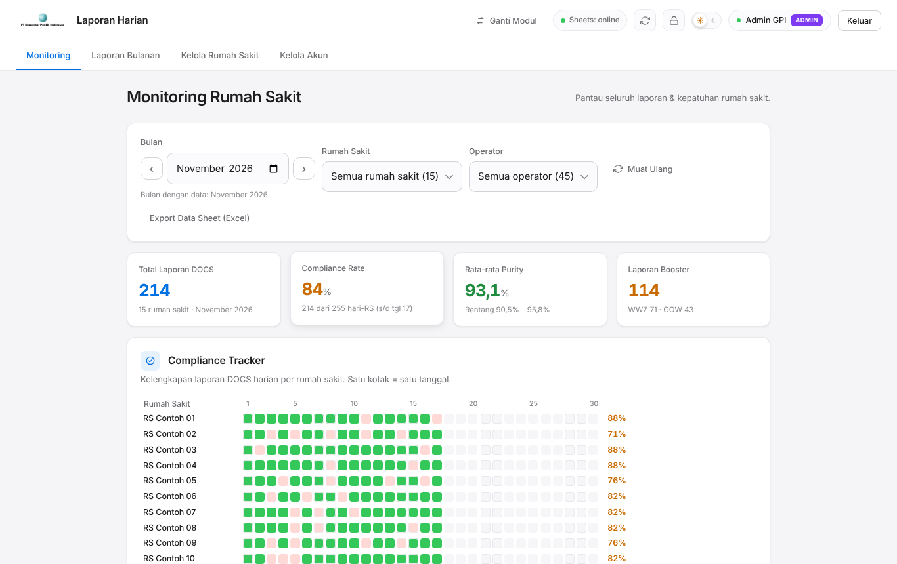
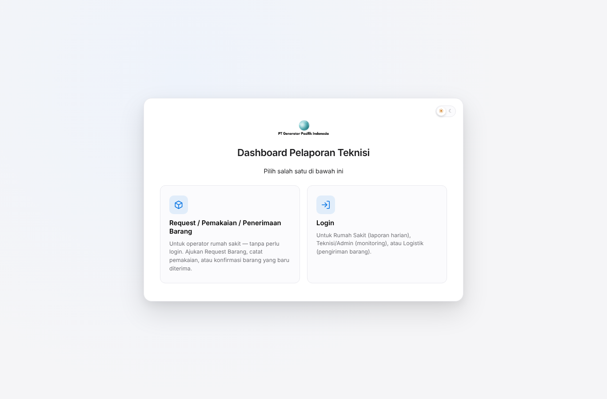
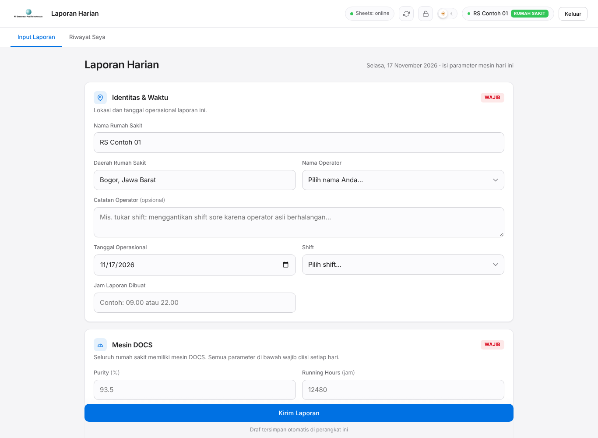
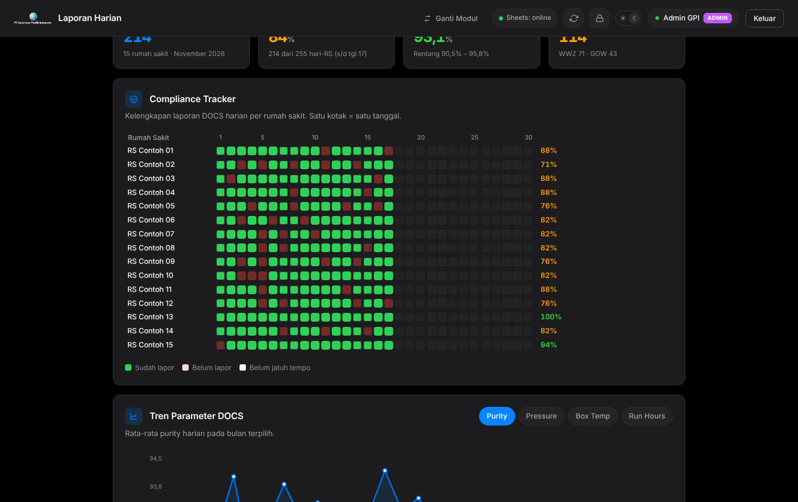

# Dashboard Pelaporan Teknisi

Web app untuk pelaporan harian mesin oxygen generator (DOCS) dan booster compressor (WWZ/GOW) yang terpasang di rumah sakit, ditambah modul stok sparepart. Tujuannya sederhana: laporan yang tadinya dicatat di kertas sekarang diisi operator lewat browser, langsung masuk ke Google Sheets, lalu bisa dipantau teknisi dan admin dari satu tempat.



## Tentang project ini

Project ini saya kerjakan selama magang di PT Generator Pasifik Indonesia. Sebelumnya, operator di rumah sakit mencatat parameter mesin di lembar checklist kertas, lalu datanya direkap manual untuk laporan bulanan. Dashboard ini menggantikan alur itu: operator mengisi form dari HP, data langsung masuk ke Google Sheets, dan tim teknisi bisa memantau semua lokasi dari satu halaman.

Pengerjaannya pakai pendekatan *vibe coding*. Saya menyusun kebutuhan, alur, dan aturan bisnisnya (role, validasi, format laporan) dari diskusi dengan tim teknisi dan atasan, lalu kodenya ditulis bersama AI assistant. Bagian saya lebih banyak di mendefinisikan masalah, mengecek dan menguji hasilnya di server lokal, lalu memperbaikinya berdasarkan masukan dari pengguna di lapangan.

Beberapa hal yang saya pelajari dari project ini:

- Memakai Google Apps Script dan Google Sheets sebagai backend gratis tanpa perlu server sendiri.
- Merancang role dan hak akses untuk Admin, Teknisi, Rumah Sakit, dan Logistik.
- Membuat mock server lokal supaya fitur baru bisa diuji tanpa mengganggu data produksi.
- Iterasi dari feedback pengguna nyata, misalnya tampilan tabel yang terpotong di HP dan laporan dobel dari shift yang berbeda.

## Fitur

- Login dengan empat role: Admin, Teknisi, Rumah Sakit, dan Logistik. Tab dan menu menyesuaikan role yang masuk.
- Form laporan harian mesin DOCS, plus booster WWZ/GOW kalau RS-nya punya. Draf tersimpan otomatis di perangkat, dan laporan dobel (RS + tanggal + shift yang sama) akan diminta konfirmasi dulu.
- Halaman monitoring: KPI bulanan, compliance tracker per RS per hari, dan grafik tren parameter.
- Export ke Excel (.xlsx) tanpa library atau CDN tambahan, cukup lewat modul kecil `assets/xlsx-lite.js`.
- Arsip laporan bulanan (snapshot) yang disimpan ke Sheets.
- Modul sparepart: request barang, pengiriman, penerimaan, pemakaian, penyesuaian stok, dan rekap stok per RS. Operator RS bisa mengajukan request tanpa login.
- Notifikasi email otomatis kalau parameter mesin keluar dari batas normal.
- Light dan dark mode.

| Portal | Input laporan (akun RS) | Dark mode |
|---|---|---|
|  |  |  |

## Arsitektur

```
Browser (index.html + assets/)  --POST JSON-->  Google Apps Script (Code.gs)  -->  Google Sheets
```

- **Frontend**: HTML, CSS, dan JavaScript biasa. Tidak pakai framework dan tidak ada build step, jadi bisa di-host di static hosting mana pun.
- **Backend**: `Code.gs`, satu file Google Apps Script yang di-deploy sebagai Web App. Isinya login dan sesi, validasi, simpan laporan, kelola akun, sparepart, dan notifikasi.
- **Database**: Google Sheets. Semua tab dan header kolom dibuat otomatis oleh `Code.gs` saat pertama kali dipanggil.

Tanpa server yang perlu dirawat dan tanpa biaya hosting bulanan.

## Coba di lokal

Cukup Python 3, tidak perlu install library apa pun.

```bash
python local_test_server.py --seed
```

Di Windows bisa juga dobel klik `JALANKAN.bat`.

Browser akan terbuka ke `http://127.0.0.1:8091`. Server ini meniru API `Code.gs`, jadi semua alur bisa dicoba tanpa Google Sheets. Datanya disimpan di `mock_data.json`.

Akun contoh dari `--seed`:

| Role | Username | Password |
|---|---|---|
| Admin | `admin` | `admin123` |
| Teknisi | `teknisi1` | `teknisi123` |
| Rumah Sakit | `rs01` sampai `rs15` | username + `123`, misalnya `rs01123` |

Opsi lain: `--reset` untuk menghapus data lokal, `--port 9000` untuk ganti port, dan `--host 0.0.0.0` supaya bisa dibuka dari HP di Wi-Fi yang sama.

## Deploy ke Google Sheets

1. Buat Google Sheet baru, buka **Extensions > Apps Script**, lalu tempel isi `Code.gs`.
2. Deploy sebagai **Web app** (Execute as: Me, Who has access: Anyone).
3. Salin URL `/exec` yang didapat ke konstanta `DEFAULT_GAS_URL` di `assets/app.js`.
4. Buka `index.html`. Karena belum ada akun, dashboard akan meminta kamu membuat akun Admin pertama.

Langkah lengkap dan troubleshooting ada di [docs/setup-apps-script.md](docs/setup-apps-script.md).

## Bundel jadi satu file

```bash
python build_single_file.py
```

Perintah ini menggabungkan `index.html`, CSS, JS, dan gambar menjadi satu file `Dashboard_Teknisi_GPI.html` yang bisa langsung dibagikan atau di-upload ke hosting statis.

## Struktur folder

```
.
├── index.html             halaman utama (login, form, monitoring, sparepart)
├── assets/
│   ├── app.js             logika frontend
│   ├── styles.css
│   ├── xlsx-lite.js       penulis file .xlsx
│   └── img/
├── Code.gs                backend Google Apps Script
├── local_test_server.py   mock backend untuk uji coba lokal
├── build_single_file.py   bundel ke satu file HTML
├── JALANKAN.bat           shortcut menjalankan server lokal di Windows
└── docs/
```

## Catatan

- Semua data di repo ini dummy (RS Contoh 01-15, Operator 1A, dan seterusnya).
- Password masih disimpan plain text di Google Sheets. Hashing password masuk daftar perbaikan berikutnya, jadi akses edit ke Sheet-nya perlu dibatasi.
- Tech stack: JavaScript, HTML/CSS, Google Apps Script, Google Sheets, Python (server lokal).
